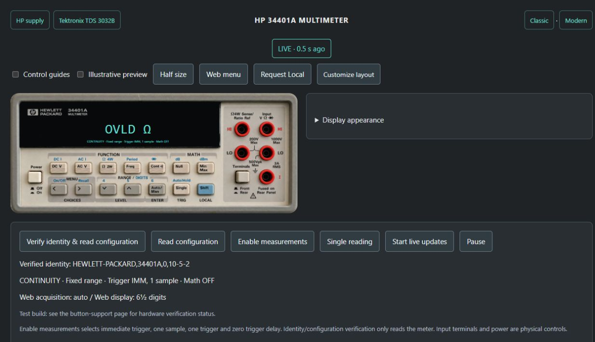

# HP 34401A Web Controller

Classic photographic and Modern dashboards for the HP 34401A multimeter, with coordinated USB-GPIB access and optional integration with the HP 6033A and Tektronix controllers.



## Install and update

For a fresh Raspberry Pi OS installation with the `pi` account, use the signed suite installer and select the controllers you want:

```sh
curl -fsSLO https://raw.githubusercontent.com/RLF62/instrument-suite/main/bootstrap.sh && sudo bash bootstrap.sh
```

For installations already enrolled in the signed updater:

```sh
sudo instrument-suite check
sudo instrument-suite update --dry-run
sudo instrument-suite update
```

[Installation and recovery guide](https://github.com/RLF62/instrument-suite/blob/main/ONE_COMMAND_UPDATER.md) · [Stable signed release](https://github.com/RLF62/instrument-suite/releases/latest)

HTTPS web maintenance reuses the existing dashboard credentials. Trusted-LAN HTTP installations can explicitly enable password-free updates. Terminal maintenance uses sudo. Existing legacy installations require [attended migration](https://github.com/RLF62/instrument-suite/blob/main/GATEWAY_MIGRATION.md); the bootstrap does not overwrite an enrolled updater.

Select only the meter if you do not need the supply application. The [original standalone workflow](STANDALONE.md) and [integrated installer](INSTALL.md) remain documented separately. The suite repository maintains the central ZIP installers and checksums.

## Features

- DC/AC voltage and current, resistance, frequency/period, continuity/diode and DC ratio.
- Primary and shifted buttons, range, digits, math, trigger and explicit web-menu equivalents.
- State readback, live chart, display font/color/transparency and optional control guides.
- Move, resize and hide panels with retained browser preferences.
- Shared adapter broker with serialized transactions, bounded timeouts and meter cooldown.
- Local operating manual, screenshots, button mappings, troubleshooting and suite navigation.

## Open the controller

Fresh signed installations use port 8082. Open `/multimeter/classic`, `/multimeter/modern` or `/multimeter/assets/docs/index.html` on the installed host. Existing HTTPS deployments retain the same paths behind the gateway.

## Documentation

- [Documentation index](DOCUMENTATION.md)
- [Operating manual](hp34401a/static/docs/index.html)
- [Button support](hp34401a/static/button-support.html)
- [Original standalone installer](STANDALONE.md)
- [Original integrated installer](INSTALL.md)
- [Add/remove instruments](CATALOG.md)
- [Gateway migration](GATEWAY_MIGRATION.md)

## Verification

Connected identity: `HEWLETT-PACKARD,34401A,0,10-5-2`. Function/configuration readback, immediate/BUS acquisition, basic math, shared meter/supply traffic, timeout isolation and recovery were exercised. Fresh installation and signed HTTPS activation passed at suite level.

External trigger pulse capture and physical Local annunciator behavior remain unverified. These checks are not a calibrated measurement-accuracy claim.

## Attribution and licensing

Panel photo by Afandrf, with prior edits attributed to Pittigrilli. The modified panel and screenshots remain [CC BY-SA 4.0](https://creativecommons.org/licenses/by-sa/4.0/); see [attribution and modifications](hp34401a/static/ATTRIBUTION.txt). Image/document licensing does not grant a separate application-code license. No manufacturer PDF is bundled.

Runtime configuration, passwords, private backups and personal captures are excluded.
