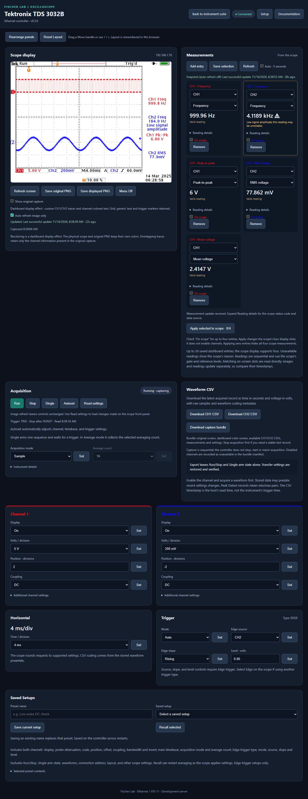

# Fischer Lab Tektronix Ethernet Controller

Browser control for an Ethernet-connected Tektronix TDS 3000-series oscilloscope. Tested with a front panel labeled TDS 3032B that reports TDS 3052B firmware v3.27. The controller displays the reported identity and does not change the instrument model.

## Install and update

For a fresh Raspberry Pi OS installation with the `pi` account, use the signed suite installer and select the controllers you want:

```sh
curl -fsSLO https://raw.githubusercontent.com/RLF62/instrument-suite/main/bootstrap.sh && sudo bash bootstrap.sh
```

For installations already enrolled in the signed updater:

```sh
sudo instrument-suite check
sudo instrument-suite update --dry-run
sudo instrument-suite update
```

[Installation and recovery guide](https://github.com/RLF62/instrument-suite/blob/main/ONE_COMMAND_UPDATER.md) · [Stable signed release](https://github.com/RLF62/instrument-suite/releases/latest)

HTTPS web maintenance reuses the existing dashboard credentials. Trusted-LAN HTTP installations can explicitly enable password-free updates. Terminal maintenance uses sudo. Existing legacy installations require [attended migration](https://github.com/RLF62/instrument-suite/blob/main/GATEWAY_MIGRATION.md); the bootstrap does not overwrite an enrolled updater.

The original user-service installer remains available: extract the source into a staging folder, install its Python requirements in a venv, then run `bash install.sh --check` and `bash install.sh --apply`. See [deployment and startup](DEPLOYMENT.md) for the distinction between standalone user services and suite services.

## Open the controller

- Dashboard: `http://CONTROLLER_HOST:8081/`
- Setup: `http://CONTROLLER_HOST:8081/setup`
- Documentation: `http://CONTROLLER_HOST:8081/docs/`

The controller host is the Pi. Setup's scope connection address is the instrument's own address. The direct scope dashboard uses trusted-LAN HTTP and does not inherit the supply's HTTPS login.



## Documentation

- [Documentation index](DOCUMENTATION.md)
- [Operating guide](docs/index.html)
- [Deployment, startup and validation](DEPLOYMENT.md)
- [Historical development and validation notes](docs/DEVELOPMENT_HISTORY.md)
- [Tektronix Programmer Manual 071-0381-03](https://download.tek.com/manual/071038103web.pdf)

## Measurements

The dashboard has a saved list of up to 20 entries. Each entry independently selects CH1 or CH2 and Frequency, Period, Peak-to-peak, RMS voltage, or Mean voltage. Add, remove and save entries. Refresh manually or enable automatic refresh.

The scope's own measurement display has four slots. Check **On scope** for at most four dashboard entries and explicitly press **Apply selected to scope**. Slot source, type and enabled state are read back. Unselected slots are turned off. Applying an empty selection hides all four. The source channel must already be enabled; the controller does not silently turn it on. Saving dashboard entries does not apply them to the scope.

Measurement DATA? qualifiers distinguish errors from warnings. Finite values with warning 541 (low signal amplitude), 542 (unstable distribution) or 543 (limited resolution) are shown as uncertain with plain-language explanations. Invalid/nonfinite/sentinel readings remain unavailable. Status code and raw response are in Reading details. An off channel returns no numeric result.

An active on-screen slot matching the entry channel/type is read directly with MEASn:DATA?. Other measurement requests temporarily use the immediate-measurement source and type, then restore and verify them. They do not rewrite the scope's display slots. Readings are sequential, can span several acquisitions, and use the instrument's existing measurement gate/reference settings. The five initial types are the currently verified dashboard choices.

## Waveform CSV

CH1 and CH2 downloads contain actual stored waveform values, not points digitized from the screen.

The controller requests signed, 16-bit, big-endian data using WAVFRM?, which supplies the record's preamble and binary data. It validates binary block length, sample count, format, units and finite scaling values.

Conversion uses:

    time_seconds = xzero + xincr * (zero_based_point_index - pt_off)
    voltage_volts = yzero + ymult * (raw_sample - yoff)

A Sample/Average record has time_seconds, voltage_volts and raw_sample columns. Peak Detect/Envelope records use one row per min/max pair with time_seconds, voltage_min_volts, voltage_max_volts, raw_min and raw_max. A verified 10000-value Peak Detect record produced 5000 min/max rows.

Metadata includes channel, reported identity, host waveform-read timestamp in UTC, waveform identifier, point count/format, scaling factors, and acquisition state before/after. The timestamp is the host read time, not an instrument trigger timestamp.

**A download retrieves the latest stored record. It may predate recent settings changes.** The warning appears in both the interface and CSV metadata. The stored record's own scaling is used. To obtain fresh data, acquire a new record with Run or Single and a suitable trigger.

Export sends no acquisition-state commands. Running, stopped and armed Single exports were tested. A Single sequence may naturally finish during a download; the controller does not rearm or resume it.

Transfer source, range, byte width, binary representation, byte order and encoding are saved, restored in finally, and read back. Custom ASCII/1-byte/partial-range settings were verified to restore after a full binary export. A restoration failure returns an error rather than a successful CSV.

Channels must be enabled and have acquired data. The scope can return null/stored records for newly enabled or previewed channels; export does not force a fresh acquisition or infer validity from a flat trace.

## Acquisition and channels

**Autoset** sends the documented AUTOSET EXECUTE command. The dashboard uses bounded BUSY? polling, then reads actual settings and refreshes controls and the capture. It automatically adjusts channel, timebase and trigger settings. It does not use *OPC? or *WAI. Autoset and the resulting readback/image were verified against the connected scope, then the pre-test settings were restored with the documented Undo plus readback checks.

Run selects continuous RUNSTOP acquisition and starts it. Stop stops acquisition. Single arms SEQUENCE operation. The UI polls ACQUIRE:STATE?, TRIGGER:STATE? and ACQUIRE:STOPAFTER?, showing stopped, pretrigger, waiting for trigger and capturing states. In Average mode one sequence comprises the selected count.

Sample, Peak Detect and Average modes are available. Averaging counts are powers of two from 2 to 512 and can be set when Average is active.

Both channels support display on/off, scale, position, offset, coupling, probe attenuation, 20 MHz / 150 MHz / Full bandwidth and invert. Applied values are read back; rounded or enforced values are reported.

On the tested v3.27 firmware, CHn:PROBE 10 behaves as 10× attenuation: changing it from 10 to 1 reduced the reported vertical scale by ten. This verified behavior differs from the programmer manual's inverse-gain example. Detected probes may enforce their factor; readback is authoritative. CSV conversion never applies an additional probe multiplier.

Edge trigger source, slope, level and Auto/Normal mode remain available. The controller does not replace complex trigger configurations through these simple controls.

## Channel colors and original captures

Setup saves a separate CH1 and CH2 color, with **Reset to default colors**. Dashboard channel headings/borders and measurement labels use the channel's saved color.

The documented instrument palette command offers Normal or Monochrome, not arbitrary per-channel colors. Custom captured traces therefore use a clearly labeled **dashboard display effect**. No display-palette command is sent to the scope.

The effect decodes verified 640×480 indexed PNGs. Channel-specific intensity ramps are recolored inside the plot interior, preserving DPO intensity. The separate CH1/CH2 text/readout palette entries are also mapped to their selected channel colors. The frame, grid, generic text and trigger-marker palette entries retain their original colors and all glyph shapes/positions remain unchanged. It is not a global RGB search/replace. Unknown/monochrome palettes or unsupported image layouts fall back to the original image with a visible explanation.

**Show original capture** switches to the unmodified bytes for the same frame. **Save original PNG** saves those bytes. **Save displayed PNG** saves whichever view is shown. The original is retained in an in-memory cache of 16 captures; after eviction or service restart, refresh the screen to obtain a new original/display pair.

Limits:
- An overlap contains only the final rendered pixel; a hidden trace cannot be recovered or separated.
- Any unusual in-plot graphic encoded with a trace intensity index can inherit that trace color.
- Only channel-attributed text/readouts can be matched reliably. Generic text stays unchanged.
- Pixels at the frame boundary are retained; a clipped trace touching it may retain its original edge color.
- Selected colors can have different contrast against the scope's background. Use the original view for comparison.

## Named presets and layout

Named presets are stored on the Pi (up to 50). Saving the same name replaces it. The page shows each preset's saved values before recall.

Included: both channels' display, probe, scale, position, offset, coupling, bandwidth and invert; main timebase; acquisition mode/count; Edge trigger type, mode, source, slope and level.

Excluded: Run/Stop/Single arm state, waveforms, connection address, dashboard colors/measurement selection/layout, on-scope measurement slots, measurement gates/references, and other advanced scope settings. Presets currently require Edge trigger. Recall can reset averaging as the instrument applies settings. Values are read back, and differences from the request are shown. A failed recall attempts to restore the previous included settings.

Use **Rearrange panels**, drag a Move handle or use the up/down buttons, then **Done rearranging**. The order is saved per browser. Reset Layout restores the default order. CSS uses a single-column layout on narrow screens; touch handles and button alternatives are provided. Desktop and narrow mobile layouts were inspected in the browser. Physical Android touch/drag operation remains unverified.

## Menu Off and communication recovery

CLEARMENU is documented as the equivalent of MENU OFF. It was verified to complete while Single remained armed, followed by a valid screen capture. The effect on a DHCP status box still needs confirmation when that box is actually present.

There is no *OPC? or *WAI in the Menu Off path. Such a wait can remain pending while Single awaits a trigger. An early test exposed an instrument-side Ethernet stall; the scope's e*Scope interface reset recovered communication, and the saved scope settings were restored.

All instrument traffic, including screenshots, measurements, CSV, control and connection testing, uses a thread lock plus a process file lock. A socket timeout discards the unusable RPC transport and releases the locks in finally. Tests verified a timed-out HTTP handler followed by a successful real-scope request. This prevents a stuck controller lock; it cannot guarantee recovery from an instrument-side firmware stall. No automatic scope/interface reset is performed.

If the scope itself remains unresponsive, check its front panel and network. Its built-in e*Scope configuration page has a Reset Interface function which takes about a minute. This is separate from restarting the Pi web service.

## Files retained across restart

- connection.json: scope address and timeout
- appearance.json: dashboard channel colors
- measurement-selection.json: dashboard entries and On scope selection
- presets.json: named setup presets

Files are saved atomically in the application directory. Do not replace them when updating the application. Layout is in browser local storage.

The signed suite manages its own system services and permanent runtimes. The original standalone installer uses a user service; enable lingering for unattended startup as described in its deployment guide.


## Capture bundles and setup backups

Capture Bundle collects original/displayed PNGs, available channel CSVs, measurements, settings and a manifest. Collection is sequential and does not produce a simultaneous acquisition. Unavailable channels are explained in a partial manifest; transport failure aborts collection. Stored records may predate current settings.

Setup exports connection preferences, channel colors, measurement selections and personal presets. Restore reviews and validates the file before replacement and retains an automatic backup. It does not program the physical scope or restore browser-local layout.

## Verification and limits

Current offline checks:

```sh
python -m unittest -v test_scope_io test_screen_effect test_archive_tools test_ethernet_transport
node test_refresh.js
node test_trigger.js
```

The controller has 26 Python tests and seven frontend checks. The signed suite acceptance includes fresh installation, public package verification and production activation. Connected checks covered identity, images, both-channel CSV scaling, readback, presets, capture bundles and communication recovery.

Physical Android touch behavior and the Sony example recipes remain unverified; the incomplete elevator recipe cannot be recalled. `verify_live.py` is an opt-in hardware test that temporarily changes scope settings and must not run during an acquisition you need to preserve. Do not run competing controller hosts against the same scope.

Runtime connection settings, personal presets, credentials, captures and private backups are excluded from Git.

## Classic and Modern displays

The photographed front panel is available at `/classic`; the Modern dashboard is at `/`. Both use the shared suite header. Classic embeds the waveform preview and keeps its display settings, cursors, measurements, and scope readback. The photographed Print button opens a browser print preview containing only a fresh scope screen PNG, using the printer selected on the viewing device. The Trigger, Vertical, ACQUIRE Menu, and SAVE/RECALL buttons open their matching Modern dashboard controls; Vertical uses the selected channel. The old `/static/classic-front-panel-test.html` URL remains available for existing bookmarks.

The Classic front-panel MATH button opens a resizable popup for Math display and dual waveform operations. The scope supplies the Math result; the simulated screen continues to show CH1 and CH2.
