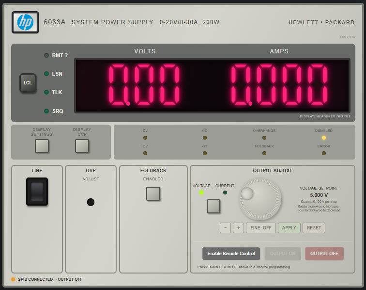
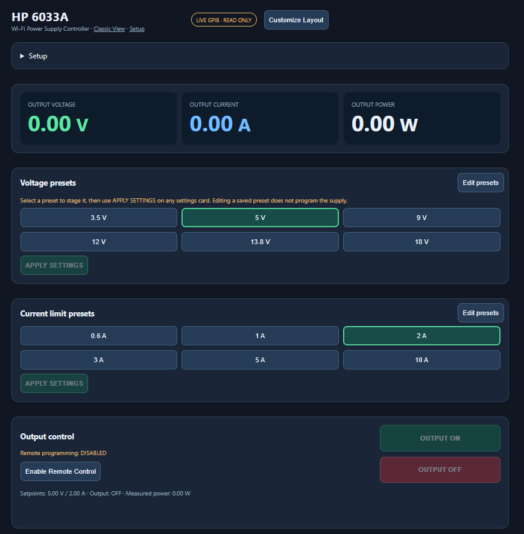
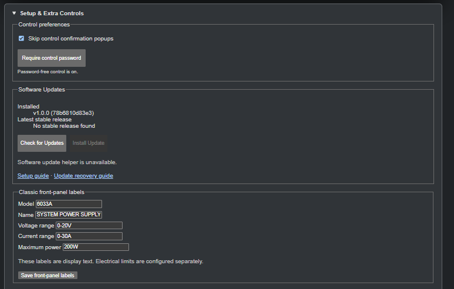

# HP 6033A Web Controller

Raspberry Pi web control and monitoring for the Hewlett-Packard HP 6033A through the [XyphroLabs UsbGpib V2 adapter](https://github.com/xyphro/UsbGpib). Tested with a real HP 6033A, rated 0–20 V, 0–30 A and 200 W.

## Install and update

For a fresh Raspberry Pi OS installation with the `pi` account, use the signed suite installer and select the controllers you want:

```sh
curl -fsSLO https://raw.githubusercontent.com/RLF62/instrument-suite/main/bootstrap.sh && sudo bash bootstrap.sh
```

For installations already enrolled in the signed updater:

```sh
sudo instrument-suite check
sudo instrument-suite update --dry-run
sudo instrument-suite update
```

[Installation and recovery guide](https://github.com/RLF62/instrument-suite/blob/main/ONE_COMMAND_UPDATER.md) · [Stable signed release](https://github.com/RLF62/instrument-suite/releases/latest)

HTTPS web maintenance reuses the existing dashboard credentials. Trusted-LAN HTTP installations can explicitly enable password-free updates. Terminal maintenance uses sudo. Existing legacy installations require [attended migration](https://github.com/RLF62/instrument-suite/blob/main/GATEWAY_MIGRATION.md); the bootstrap does not overwrite an enrolled updater.

For the original single-controller HTTPS/HTTP installer and `update.sh`, see the [standalone installation guide](static/docs/installation.html). Those tools have their own update workflow. An enrolled shared-adapter suite uses `instrument-suite` maintenance.

## Features

- Classic front panel and Modern dashboard with live voltage, current and power history.
- Voltage/current controls, presets, output state and explicit remote-programming controls.
- Move, resize and hide dashboard panels; retained browser layout preferences.
- Configurable Classic labels and display preferences.
- HTTPS and configurable control authentication, local manuals, favicon and Android shortcut icons.
- Shared instrument menu and coordinated adapter access when installed through the suite.

## Screenshots

### Classic front panel



### Modern dashboard



### Setup and extra controls



Screenshots are illustrative; the Setup image includes the older optional single-controller updater.

## Open the controller

The Modern dashboard is `/`; Classic is `/classic-dual`; documentation is `/docs/`. Fresh signed installations use port 8083. Existing HTTPS deployments retain their configured address.

## Documentation

- [Documentation index](DOCUMENTATION.md)
- [Operating manual](docs/index.html)
- [Project and architecture](static/docs/project.html)
- [Command reference](static/docs/commands.html)
- [Original standalone installer](static/docs/installation.html)
- [Standalone recovery](static/docs/recovery.html)
- [Suite installation and maintenance](INSTRUMENT_SUITE.md)

## Hardware and safety

Verified with the HP 6033A, Raspberry Pi and UsbGpib V2. Other compatible HP supplies have not been verified. Verify voltage/current limits before enabling output and use the controller's deliberate remote-control and confirmation steps. Display labels do not enforce electrical limits.

Supply and meter share one broker in suite mode. Do not start a direct-VISA controller alongside that broker. Never rely on software alone for electrical safety.

Runtime configuration, credentials, certificates, private backups and captures stay outside the repository.
